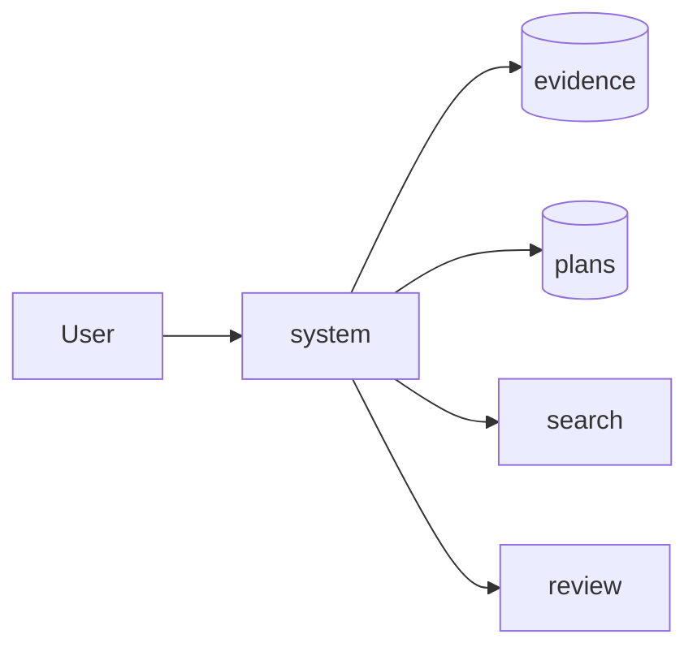
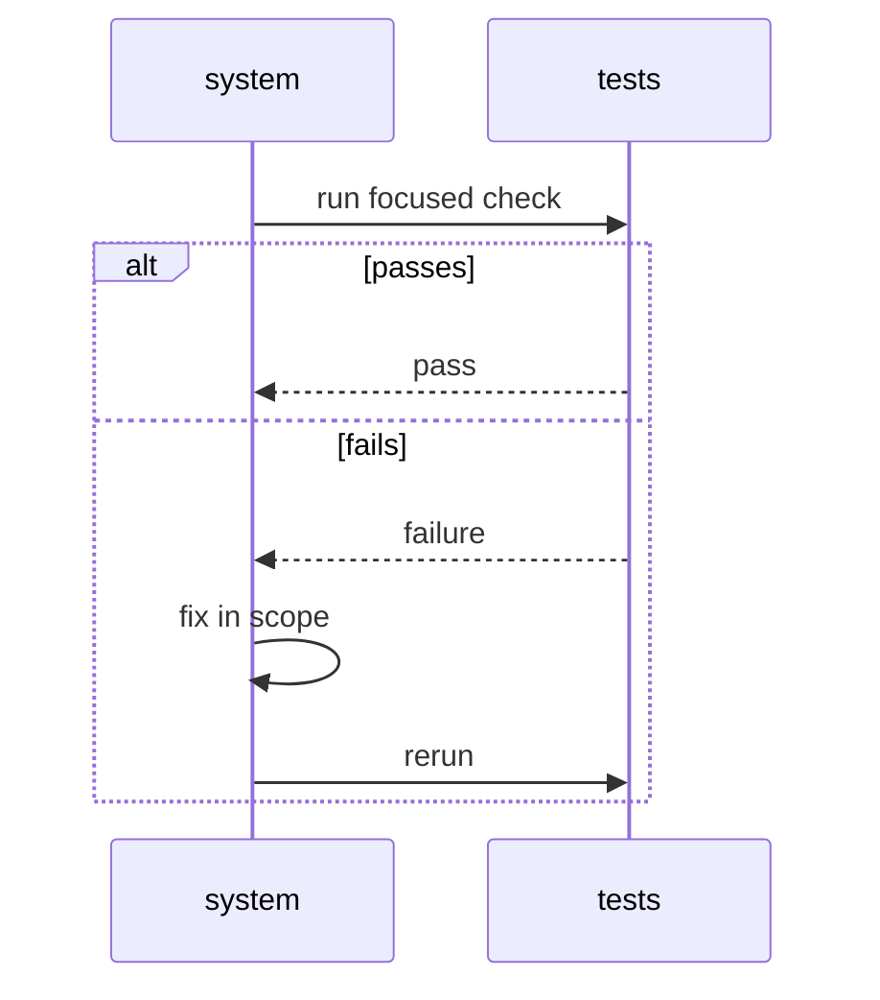

# Mermaid diagrams

OpenCode's TUI and graphical clients render ` ```mermaid ` fenced blocks as
diagrams. That is the only way to show a diagram: write the Mermaid source, not
ASCII art and not a custom tool call.

## When to use

Use a diagram when the relationships are easier to see than to read:

- a flow or decision path (`flowchart`)
- a request/response exchange (`sequenceDiagram`)
- a lifecycle or state machine (`stateDiagram-v2`)
- an architecture or component boundary (`flowchart` with subgraphs)
- a data model (`erDiagram` or `classDiagram`)

Skip the diagram when a short paragraph or a list is clearer. Pair every diagram
with one or two sentences that say what it shows and why it matters.

## Format

- Keep a diagram small: aim for 4–12 nodes, and split a large one rather than
  shrinking it.
- Prefer `flowchart TD` for top-down flows and `flowchart LR` for pipelines.
- Use short node IDs and readable labels: `A[User]`, `B[Evidence]`.
- Quote labels that contain spaces, punctuation, or parentheses:
  `A["Store (v2)"]`.
- Do not put Markdown links, HTML, or backticks inside labels.
- Use subgraphs for ownership or deployment boundaries, not decoration.
- Do not include a title inside the Mermaid source; put the title in the prose
  before the block.

Examples:

````markdown
The request path keeps writes single-threaded while research and review run in
isolated contexts:


````

````markdown
The review loop only reruns the affected check:


````

## Rendering

OpenCode renders the fence natively in the TUI and in graphical clients. Do not
call a separate diagram tool and do not paste rendered ASCII: the fence is the
durable, copyable source, and the client draws it. If a future client does not
render Mermaid, the source is still readable and can be opened later.
